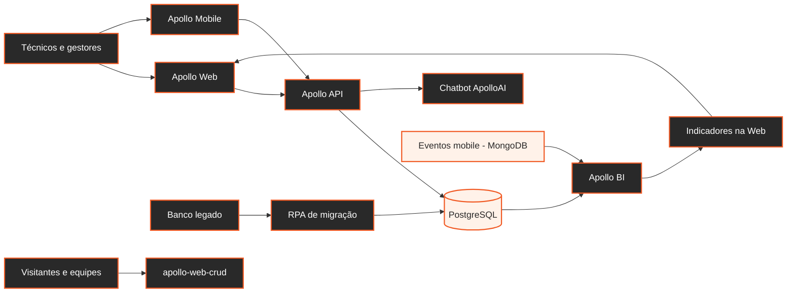

# ☀️ Apollo

  <strong>Plataforma integrada para gestão de ativos fotovoltaicos</strong> 
  Operação, manutenção e análise em um ecossistema conectado.

  

  <a href="#ecossistema">Ecossistema</a> ·
  <a href="#equipes-e-repositórios">Equipes e repositórios</a>

  
  
  
  
  
  

---

## Ecossistema

Uma iniciativa interdisciplinar desenvolvida por equipes do primeiro e do segundo ano, com requisitos distintos e entregas complementares.

## Equipes e repositórios

O **primeiro ano** desenvolve a landing page e a área restrita com operações CRUD. O **segundo ano** desenvolve os sistemas integrados de operação, inteligência artificial, dados e serviços de apoio.

| Repositório | Equipe | Responsabilidade e tecnologias |
| --- | --- | --- |
| [Apollo-Web](https://github.com/ApolloOficial/Apollo-Web) | 2º ano | Painel para ativos, filiais, alertas, ordens de serviço, realocações e indicadores. React, TypeScript e Vite. |
| [apollo-web-crud](https://github.com/ApolloOficial/apollo-web-crud) | 1º ano | Landing page e área restrita com operações CRUD. |
| [Apollo-Mobile](https://github.com/ApolloOficial/Apollo-Mobile) | 2º ano | Aplicativo Android para técnicos em campo: consulta de ativos, leitura de códigos e gestão de problemas e ordens de serviço. |
| [Apollo-API-Spring](https://github.com/ApolloOficial/Apollo-API-Spring) | 2º ano | API REST central para autenticação e operações de negócio. Java, Spring Boot e PostgreSQL. |
| [Chatbot-ApolloAI](https://github.com/ApolloOficial/Chatbot-ApolloAI) | 2º ano | Assistente conversacional integrado à plataforma, com agentes, RAG e memória. Flask, LangChain/LangGraph, Qdrant, MongoDB e Redis. |
| [Access-Log-Api](https://github.com/ApolloOficial/Access-Log-Api) | 2º ano | Serviço para registro e consulta de acessos. Spring Boot e MongoDB. |
| [Apollo-BI](https://github.com/ApolloOficial/Apollo-BI) | 2º ano | Pipeline de dados e indicadores para o dashboard. Databricks, PySpark e Delta Lake. |
| [RPA-data-migration](https://github.com/ApolloOficial/RPA-data-migration) | 2º ano | Automação para validar e migrar cadastros do banco legado para o Apollo. Python. |

---

Projeto Interdisciplinar 2026 · Equipe Apollo ☀️

